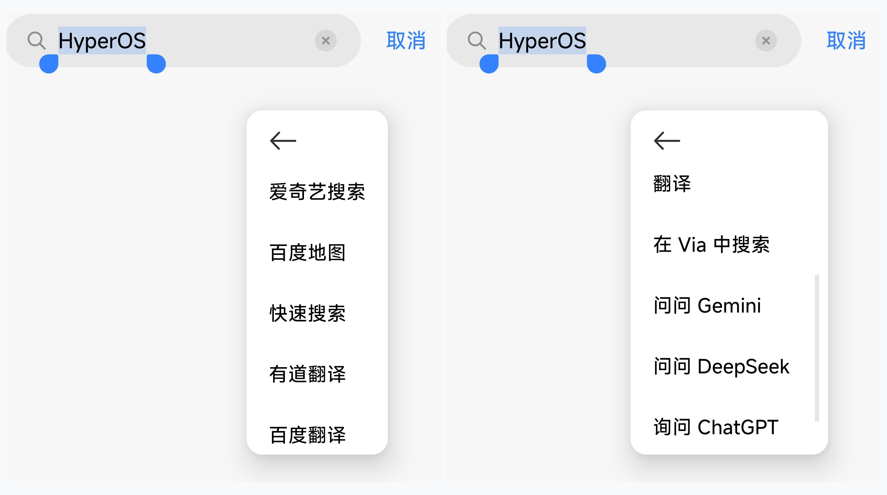
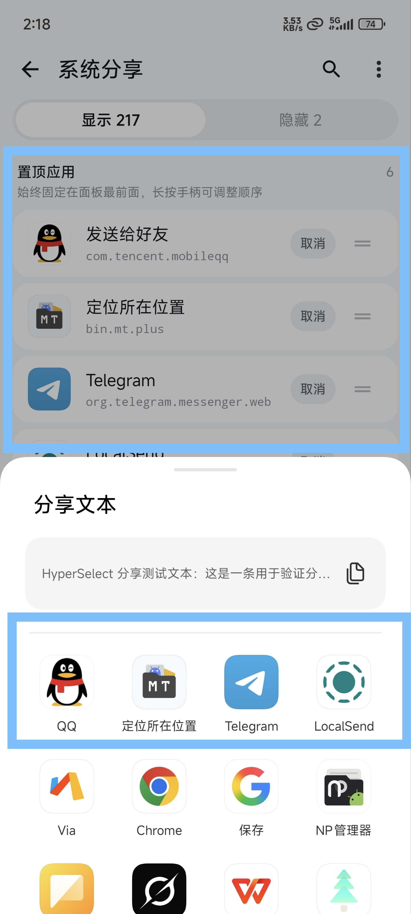

# HyperSelect

适用于小米澎湃系统（Xiaomi HyperOS）的文本长按菜单、系统分享与打开方式净化模块。

---

## 功能特性

### 1. 文本长按菜单净化
- **屏蔽 AI 写作气泡**：彻底移除强制出现在选词栏首位的小米便签 AI 写作小圆圈，让「复制、粘贴、全选」回归正常位置。
- **左滑快速隐藏**：向左滑动任意不需要的功能项，一键移入隐藏名单，精简菜单长度。
- **长按拖拽排序**：按住卡片右侧手柄，自由调整每个菜单项的先后展示位次。

  

  
   
  更多菜单对比：左为系统原生冗余项，右为自由净化调序后的常用工具与 AI

### 2. 系统分享与打开方式定制
- **常用应用常驻置顶**：将微信、QQ、常用浏览器或解压工具等固定在面板最前端，绝不被临时应用冲乱。
- **未置顶项自然流动**：未置顶的常规应用保留系统原生的使用习惯排序，不影响日常手感。
- **左滑一键收纳隐藏**：滑动隐藏低频或极少使用的应用，大幅精简弹窗高度。
- **手柄拖拽微调次序**：已置顶的应用之间可长按手柄自由调整先后顺序。

  

### 3. 体验与细节
- **原生无感**：完全贴合 HyperOS 设计语言，支持触感震动反馈。
- **即时生效**：规则修改无需重启手机或强退应用，即改即用，支持手势误操作一键撤销。
- **极轻体积**：安装包仅约 1.1MB，无常驻后台服务，零额外耗电。

---

## 兼容性与运行环境

- **实测通过**：Xiaomi HyperOS 2.0 / OS 3
- **理论兼容**：Xiaomi HyperOS 1.0+
- **XP 框架**：LSPosed（基于 LibXposed API 102）
- **作用域**：`system`（系统框架）与 `com.android.intentresolver`（系统分享与选择器）

---

## 开源协议

本项目采用 [GNU General Public License v3.0](LICENSE) 开源协议。
